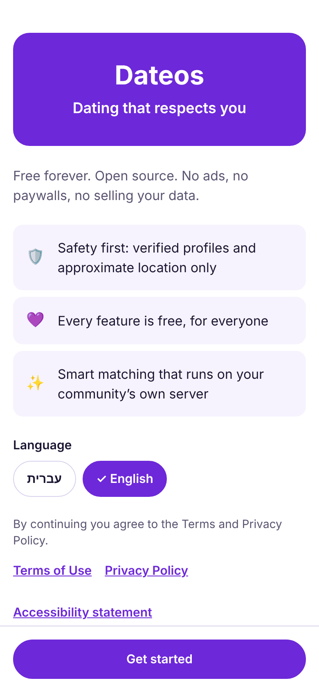
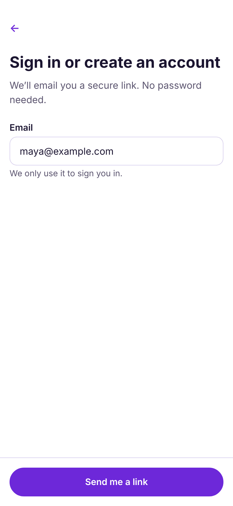
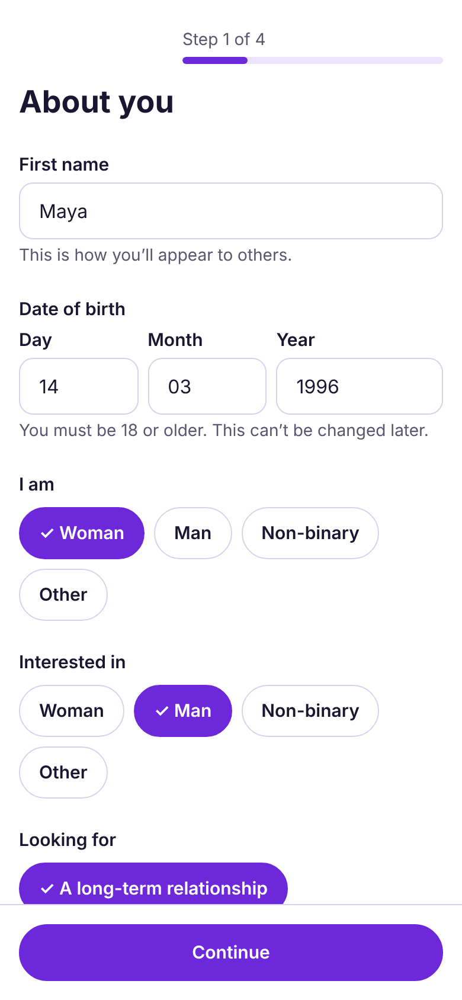
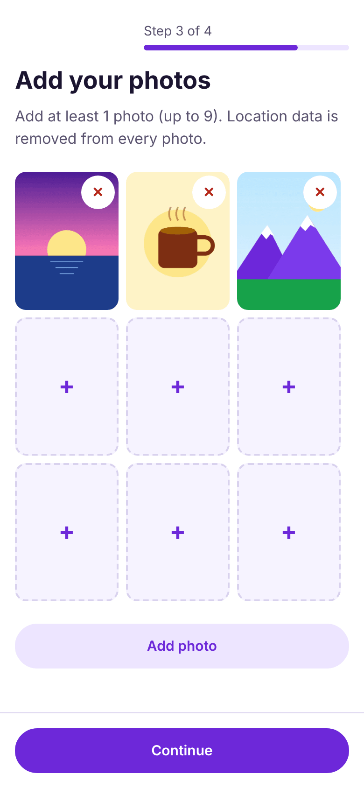
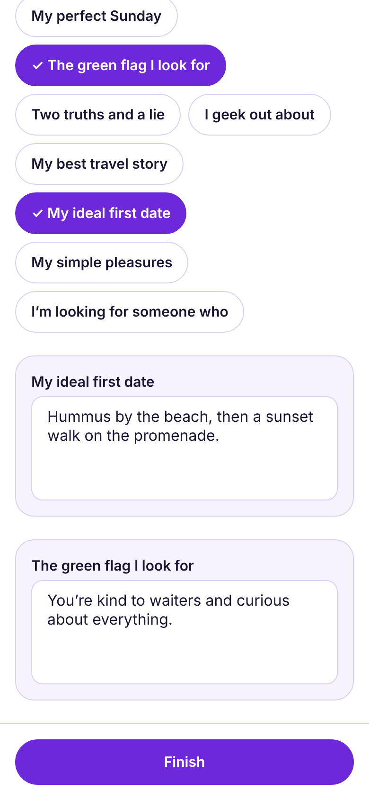
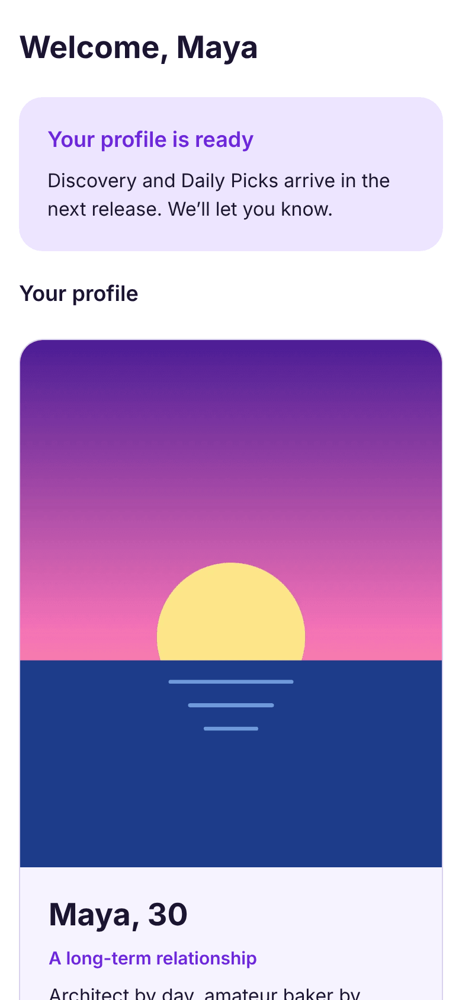
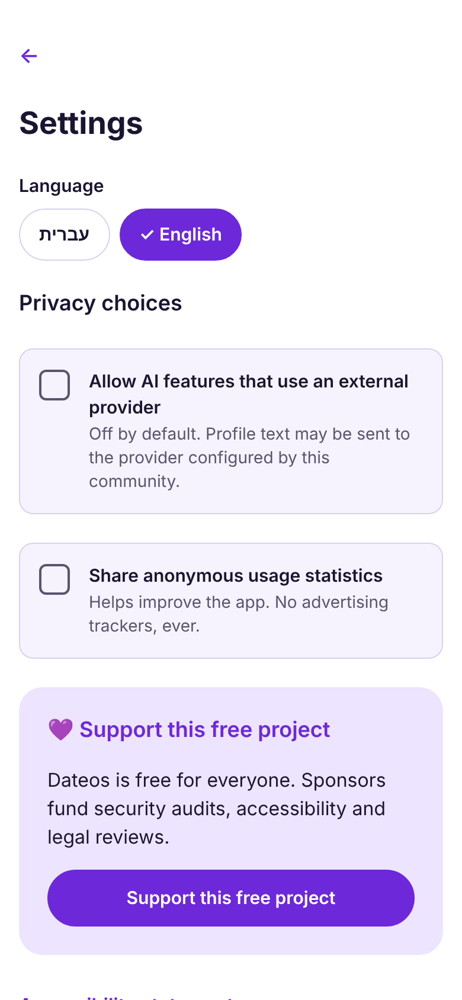
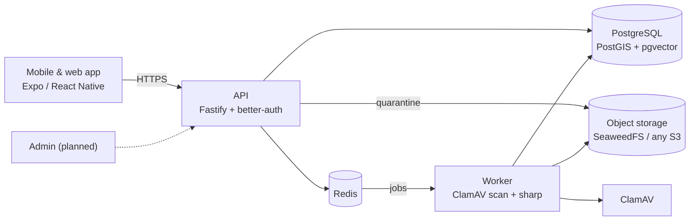

<div align="center">

# Dateos

**The free, open-source dating platform anyone can run.**
Native iOS & Android plus web from one codebase, privacy by design, and safety built in from day one.

[](https://github.com/diamondrubinny/Dateos/actions/workflows/ci.yml)
[](LICENSE)
[](#accessibility)
[](https://github.com/sponsors/diamondrubinny)


<sub>Real screenshots of the current web build, captured automatically by <a href="e2e/screenshots.ts">e2e/screenshots.ts</a>. Profile photos are illustrations; no real people appear.</sub>

</div>

---

## Why Dateos?

Most dating apps make money by keeping you swiping, selling "boosts", and monetising your data.
Dateos is built the other way around:

- 🆓 **Free for everyone, forever.** No premium tier, no paywalls, no ads, no selling data. MIT licensed.
- 🏠 **Run your own instance.** A city, a community or an organisation can launch a branded dating app with one install script.
- 🛡️ **Safety first.** Photos are scanned for malware and stripped of location data. Location is only ever approximate. Under-18 sign-ups are blocked.
- 🔒 **Privacy by design.** Passwordless sign-in, minimal data, versioned consent, and full account deletion from inside the app.
- 🤖 **AI that respects you.** Matching and assistance run on the instance's own server by default; cloud AI is opt-in only.
- ♿ **Accessible and bilingual.** Hebrew (RTL) and English, screen-reader labels, keyboard navigation, and a button for every gesture.

## Status

Dateos is in active development. Here is what works today and what comes next. The full plan is in [`docs/PLAN.md`](docs/PLAN.md).

| Area                                                                           | Status            |
| ------------------------------------------------------------------------------ | ----------------- |
| Passwordless email sign-in (magic link), sessions, rate limits                 | ✅ Available      |
| Profile, preferences, prompts, versioned consents                              | ✅ Available      |
| Photo upload with malware scan (ClamAV), EXIF/GPS stripping, re-encoding       | ✅ Available      |
| Account deletion (all data and files)                                          | ✅ Available      |
| iOS / Android / web app: onboarding, profile, settings (Hebrew + English, RTL) | ✅ Available      |
| Discovery, reciprocal AI matching, Daily Picks, "why we matched"               | 🛠️ Next (phase 2) |
| Real-time chat, AI icebreakers, harassment filter                              | 🗓️ Phase 3–5      |
| Block / report, moderation dashboard, selfie verification                      | 🗓️ Phase 4        |
| Video dates, safety check-in, date planner                                     | 🗓️ Later          |

## Screenshots

| Welcome                                                                         | Sign in                                                                        | Profile                                                                       | Photos                                                                     | Prompts                                                                              | Profile ready                                                                  | Settings                                                                                                    |
| ------------------------------------------------------------------------------- | ------------------------------------------------------------------------------ | ----------------------------------------------------------------------------- | -------------------------------------------------------------------------- | ------------------------------------------------------------------------------------ | ------------------------------------------------------------------------------ | ----------------------------------------------------------------------------------------------------------- |
|  |  |  |  |  |  |  |

**Full right-to-left support (Hebrew):**


## Quick start

Requirements: Node.js ≥ 22.12, pnpm 10 (`corepack enable`), Docker with Compose v2, OpenSSL.

```bash
./install.sh                 # creates .env and storage credentials with strong random secrets
pnpm install
pnpm infra:up                # PostgreSQL (PostGIS + pgvector), Redis, SeaweedFS (S3)
docker compose -f infra/docker-compose.yml --env-file .env --profile full --profile dev up -d
                             # + ClamAV malware scanning, + Mailpit (catches sign-in emails)
pnpm dev                     # API on :4000 and worker (migrations run automatically)
pnpm --filter @dateos/mobile web   # app in the browser on :8081
```

Open <http://localhost:8081>, sign in with any email, and click the link in Mailpit at <http://localhost:8025>.
For iOS/Android, run `pnpm --filter @dateos/mobile start` and open the project in a development build
([Expo docs](https://docs.expo.dev/develop/development-builds/introduction/)).

<details>
<summary>More commands</summary>

| Command                                      | What it does                                                                              |
| -------------------------------------------- | ----------------------------------------------------------------------------------------- |
| `pnpm check`                                 | Format check, lint, typecheck and unit tests                                              |
| `pnpm --filter @dateos/api test:integration` | API tests against real Postgres, Redis and S3 (IDOR, underage, deletion…)                 |
| `pnpm --filter @dateos/e2e screenshots`      | Walks the whole app in a browser, regenerates screenshots and runs an axe-core WCAG audit |
| `./install.sh --force --reset-data`          | Regenerates secrets **and deletes all local data**                                        |

</details>

## Architecture



| Path               | Description                                                          |
| ------------------ | -------------------------------------------------------------------- |
| `apps/api`         | Fastify API: auth, profiles, photos, security headers, rate limiting |
| `apps/worker`      | Background jobs: malware scanning, image processing, storage cleanup |
| `apps/mobile`      | Expo Router app for iOS, Android and web (Hebrew/English, RTL)       |
| `packages/shared`  | Zod schemas and types shared by server and clients                   |
| `packages/db`      | Drizzle schema and SQL migrations                                    |
| `packages/storage` | S3 helpers                                                           |
| `infra/`           | Docker Compose and the Postgres image                                |
| `e2e/`             | Browser flow, screenshots and accessibility audit                    |

## Security and privacy

- Passwordless sign-in: magic-link tokens are single-use and stored hashed. Limits apply per IP and per inbox, and responses never reveal whether an email is registered.
- Every endpoint checks ownership on the server. Integration tests verify that one user cannot read, delete or reorder another user's photos.
- Uploads are type-checked by magic bytes, size-limited and held in a quarantine bucket until ClamAV has scanned them. They are then re-encoded with all EXIF/GPS metadata removed.
- Photos are served only through the API with an access check, never from public bucket URLs.
- Strict security headers, CORS allowlist, request size limits, log redaction of tokens, emails and phone numbers, and no stack traces in responses.
- CI runs lint, typecheck, unit and integration tests, a dependency audit, CodeQL, Gitleaks and Docker builds. Actions are pinned to commit SHAs.

Found a vulnerability? Please report it privately; see [SECURITY.md](SECURITY.md).

## Accessibility

Dateos targets **WCAG 2.1 AA** and the Israeli standard **IS 5568**. Every screen in the screenshot flow is scanned with
[axe-core](https://github.com/dequelabs/axe-core) and currently reports **0 violations**. Every control has a screen-reader label
and role, focus is visible for keyboard users, text scales up to 200%, and every swipe action has a button.
Automated checks catch only part of the issues: manual testing with VoiceOver, TalkBack and keyboard is part of the release checklist.

## 💜 Sponsor Dateos

Dateos will stay free for everyone. Sponsorships fund what a safe dating platform needs and code alone can't provide:
independent **security audits**, **accessibility audits**, **legal review** of the privacy and consent templates, and a public demo.

| Tier                | Monthly    |
| ------------------- | ---------- |
| ☕ Supporter        | **$3**     |
| 💜 Friend           | **$10**    |
| 🛡️ Safety Champion  | **$25**    |
| 🏙️ Community Host   | **$100**   |
| 🏢 Organization     | **$500**   |
| 🌍 Founding Partner | **$1,500** |

One-time gifts: **$5**, **$25**, **$100**, **$500** or any amount.

<a href="https://github.com/sponsors/diamondrubinny"></a>

What each tier includes, and what sponsorship will **never** buy (user data, moderation influence, ranking changes): [docs/SPONSORS.md](docs/SPONSORS.md).
Thank you to everyone in [SUPPORTERS.md](SUPPORTERS.md).

## Running a public instance

Whoever deploys an instance is the operator, and legal controller, of its users' data. Before going public you need, at minimum,
a reviewed privacy policy, terms of use, an accessibility statement and a moderation process.
Draft texts ship with the app but **require review by a qualified lawyer** for your jurisdiction.

## Contributing

Contributions are welcome. Please read [CONTRIBUTING.md](CONTRIBUTING.md) and the [Code of Conduct](CODE_OF_CONDUCT.md).
Security, privacy and accessibility are requirements, not extras.

## License

[MIT](LICENSE) © 2026 diamondrubinny and contributors.
