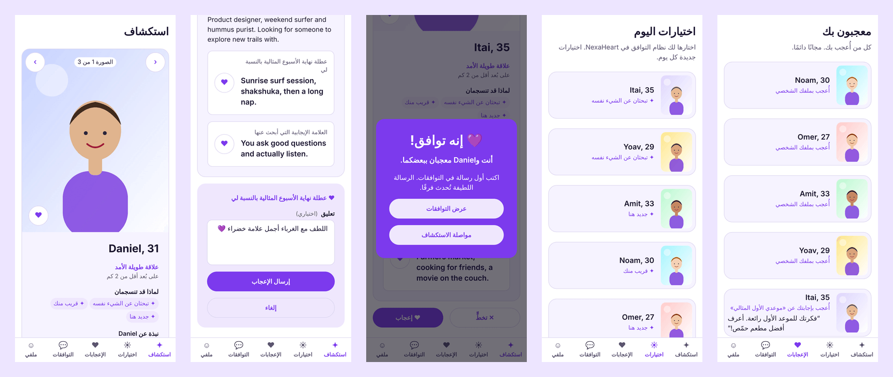
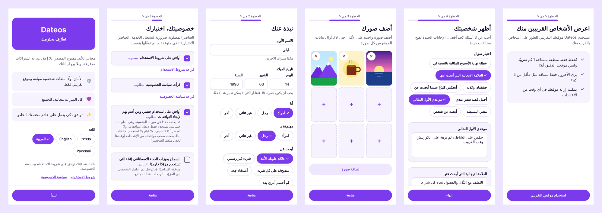
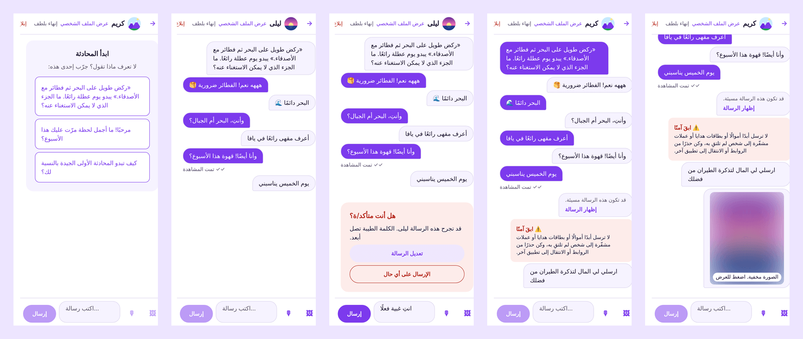
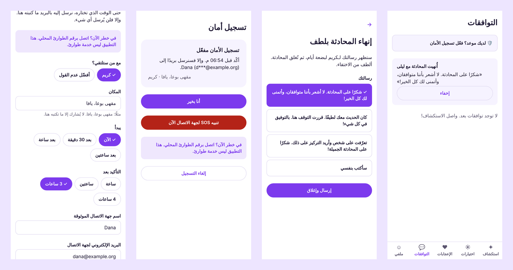
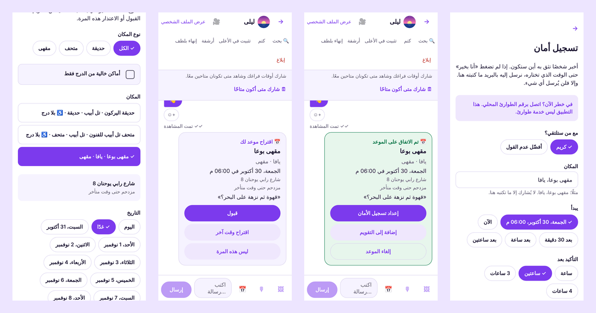
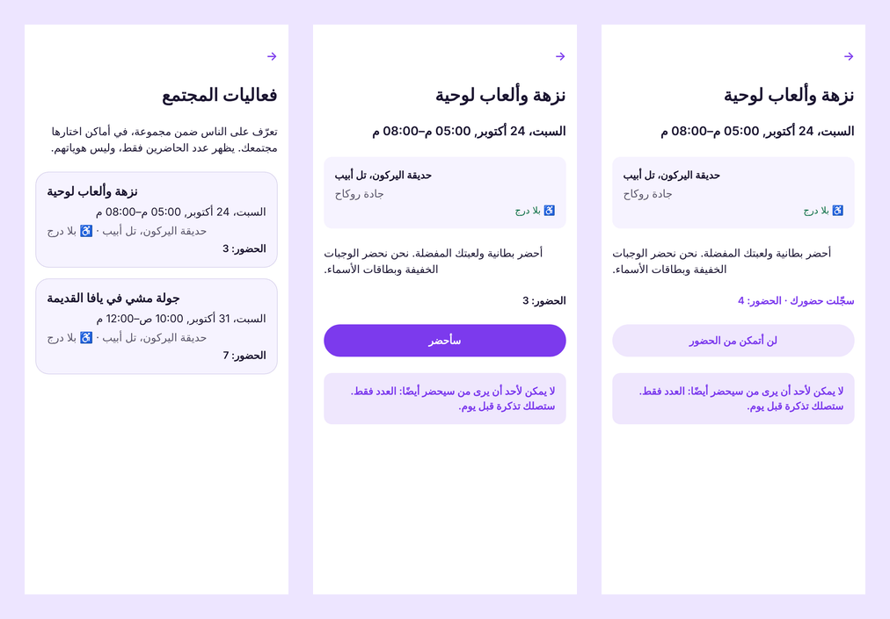
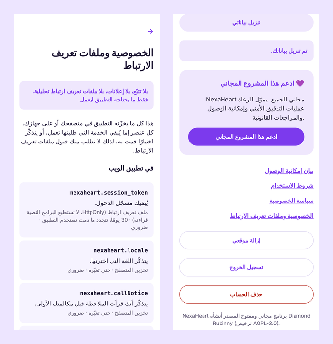

<div dir="rtl">

# NexaHeart: تعارف يحترمك

[English](en.md) · [עברית](he.md) · **العربية** · [Русский](ru.md)

**تطبيق تعارف مجاني ومفتوح المصدر لأجهزة iPhone وAndroid والويب، يمكن لأي مدينة أو مجتمع أو مؤسسة
تشغيله باسمها الخاص.** بلا إعلانات، بلا اشتراكات مدفوعة، وبلا بيع للبيانات: مجرد أشخاص يتعرّفون على
أشخاص، مع أمان وخصوصية مدمجين منذ البداية.



## لماذا NexaHeart

|                                    |                                                                                                                                                                                             |
| ---------------------------------- | ------------------------------------------------------------------------------------------------------------------------------------------------------------------------------------------- |
| 🆓 **مجاني للجميع وإلى الأبد**     | كل الميزات مجانية: معرفة من أعجب بك، محادثات بلا حدود، رسائل صوتية. لا اشتراك مميز ولا "تعزيزات". مفتوح المصدر (AGPL-3.0).                                                                  |
| 🏠 **مجتمعك، تطبيقك**              | سكربت تثبيت واحد يمنحك تطبيقًا يحمل اسمك وشعارك وألوانك، على خادمك ونطاقك الخاص. البيانات تبقى لديك.                                                                                        |
| 💞 **توافق يشرح نفسه**             | يقترح أشخاصًا يُرجَّح أن يُعجَب كلٌّ منهما بالآخر، ويوضّح السبب ("كلاكما يحب المشي في الطبيعة"، "تتحدثان لغة مشتركة")، ويوزّع الاهتمام بعدل حتى لا يُهمَل أحد. الخوارزمية منشورة للجميع.    |
| 🛡️ **الأمان من الرسالة الأولى**    | توثيق الصور يراجعه إنسان (بلا تعرّف على الوجوه)، سؤال "هل أنت متأكد/ة؟" قبل الرسائل الجارحة، إخفاء الرسائل المسيئة، تحذيرات من الاحتيال، صور مموّهة حتى تختار رؤيتها، وزر إبلاغ في كل مكان. |
| 🔒 **الخصوصية في صميم التصميم**    | دخول بلا كلمة مرور، الموقع كمنطقة تقريبية بحوالي كيلومتر واحد فقط، موافقة صريحة ومنفصلة على البيانات الحساسة، بلا ملفات تعريف ارتباط للتتبّع، و"تنزيل بياناتي" و"حذف حسابي" بنقرتين.        |
| 🤖 **ذكاء اصطناعي تحت سيطرتك**     | التوافق الذكي واقتراحات بدء المحادثة تعمل على خادمك افتراضيًا. الذكاء الاصطناعي السحابي فقط بموافقة كل عضو.                                                                                 |
| 🌍 **أربع لغات، وسهل الوصول**      | العربية والعبرية والإنجليزية والروسية، مع دعم كامل للكتابة من اليمين إلى اليسار. قارئات الشاشة، لوحة المفاتيح، النص الكبير، وزر لكل سحبة.                                                   |
| 🛟 **أمان في الموعد، وبلا اختفاء** | يرسل تسجيل الأمان بريدًا إلى شخص تثق به فقط إذا لم تؤكّد أو ضغطت SOS. وميزة "إنهاء بلطف" تُنهي المحادثة برسالة مهذبة بدل الصمت، وتذكيرات لطيفة تُظهر من ينتظر ردّك.                         |
| 📲 **تطبيق بلا متاجر**             | يُثبَّت تطبيق الويب على الشاشة الرئيسية باسم مجتمعك وأيقونته ولونه، ويفتح حتى عند إعادة تشغيل الخادم أو انقطاع الاتصال.                                                                     |
| 🧰 **يعتني بنفسه**                 | أمر واحد عبر SSH يثبّته. تظهر التحديثات في لوحة الإدارة مع ما أُضيف أو أُصلح، وتُثبَّت بموافقة المسؤول (الآن أو ليلًا)، مع نسخة احتياطية أولًا وعودة تلقائية إذا لم تعمل النسخة الجديدة.    |
| 👮 **أدوات إشراف مدمجة**           | لوحة تحكم بتسجيل دخول ثنائي إلزامي، قائمة بلاغات مع الأدلة، مراجعة التوثيق، وسجل كامل للإجراءات.                                                                                            |

## نظرة أقرب

**التسجيل في دقيقة، والموافقة أولًا**



**محادثة يسودها اللطف**



**أمان في الموعد وإنهاء بلطف**



**خطّط لموعد في مكان يثق به المجتمع**



**فعاليات المجتمع**



**خصوصية يمكنك التحقق منها**



## لمن صُمّم

- **المجتمعات والمؤسسات** التي تريد مساحة تعارف خاصة بها: مدينة، جامعة، مجتمع ديني أو ثقافي،
  منظمة لمجتمع الميم، أو شبكة مهنية.
- **الجمعيات والمبادرات الاجتماعية** التي يهمّها الأمان والكرامة أكثر من وقت الشاشة.
- **المطوّرون والمطوّرات** الذين يريدون قاعدة شيفرة حديثة ومختبرة ومفتوحة (TypeScript وReact Native وPostgreSQL).

## مبني ليستحق الثقة

- مختبر من البداية إلى النهاية: 366 اختبار تكامل، اختبارات متصفح بأربع لغات، فحوص وصول
  آلية (0 مخالفات axe-core)، واختبار حمل مع 5,000 عضو.
- مراجعة أمنية ودليل خصوصية منشوران؛ مسودات لسياسة الخصوصية وشروط الاستخدام وبيان إمكانية الوصول
  لتكييفها مع محامٍ ⚖️.
- لا يخرج شيء من خادمك إلا إذا اخترت ذلك: بلا تحليلات وبلا سكربتات من أطراف ثالثة.

## كيف تبدأ

```bash
ssh root@YOUR_SERVER_IP 'curl -fsSL https://raw.githubusercontent.com/diamondrubinny/NexaHeart/main/scripts/bootstrap.sh | DOMAIN=example.org SMTP_HOST=smtp.your-provider.example SMTP_USER=you@example.org SMTP_PASSWORD=your-smtp-password bash'
```

أمر واحد على خادم لينكس جديد عبر SSH: يثبّت Docker عند الحاجة، وينزّل NexaHeart ويهيّئه، ويُعدّ نسخًا احتياطية يومية مشفّرة والتحديثات، ويطبع رمز الإعداد. وجّه `example.org` و`admin.example.org` و`api.example.org` إلى الخادم أولًا. ثم اتّبع [الدليل خطوة بخطوة](../INSTALL.md) و[قائمة التحقق قبل الإطلاق](../PRODUCTION_CHECKLIST.md) (بالإنجليزية).

💜 **ادعم المشروع:** [GitHub Sponsors](https://github.com/sponsors/diamondrubinny) يموّل مراجعات الأمان
وفحوص إمكانية الوصول والقوالب القانونية للجميع.

<sub>أنشأ Diamond Rubinny مشروع NexaHeart. لقطات الشاشة حقيقية من الإصدار الحالي؛ صور الملفات الشخصية
رسومات توضيحية. النصوص القانونية مسودات وليست استشارة قانونية.</sub>

</div>
