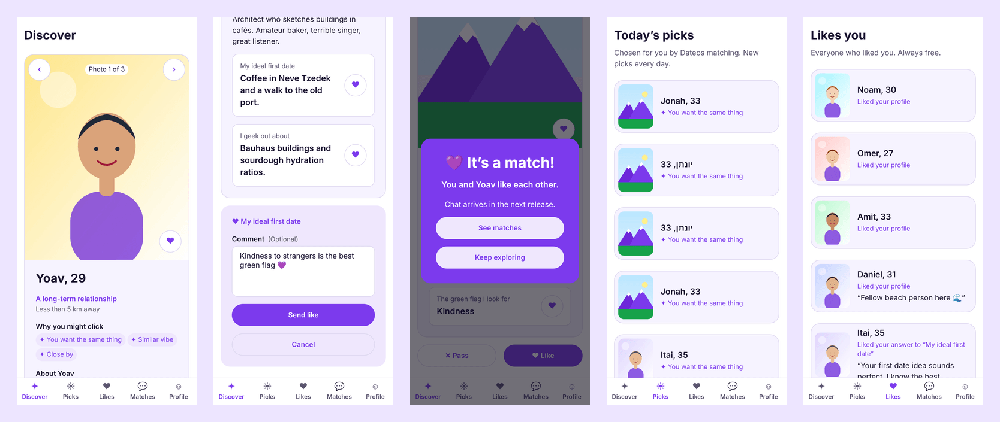
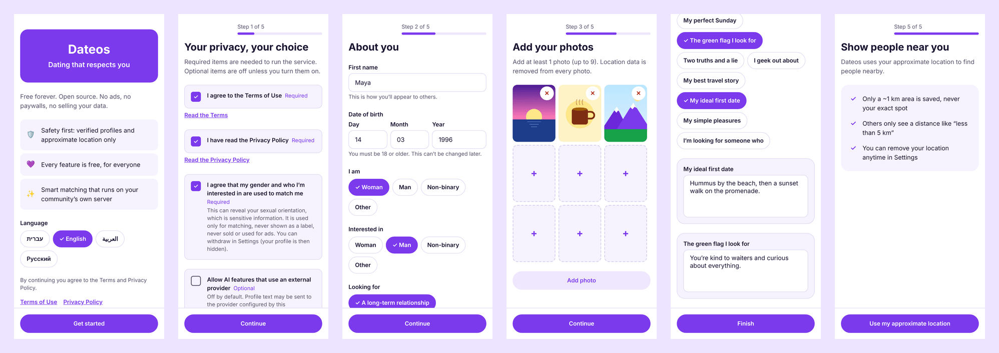
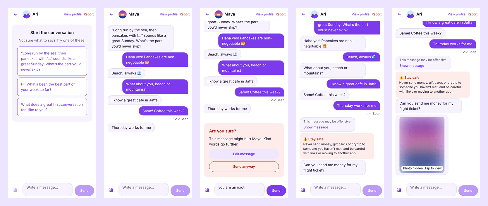
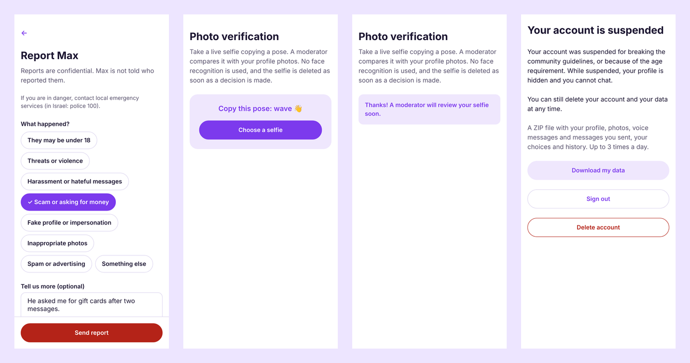
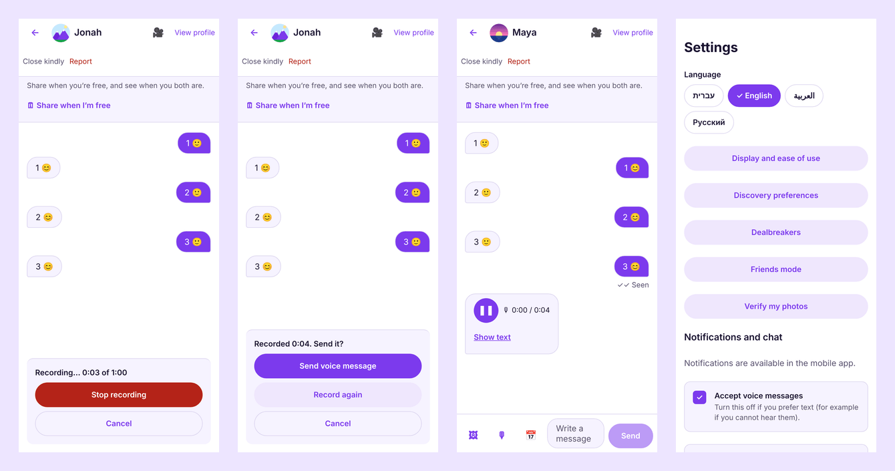
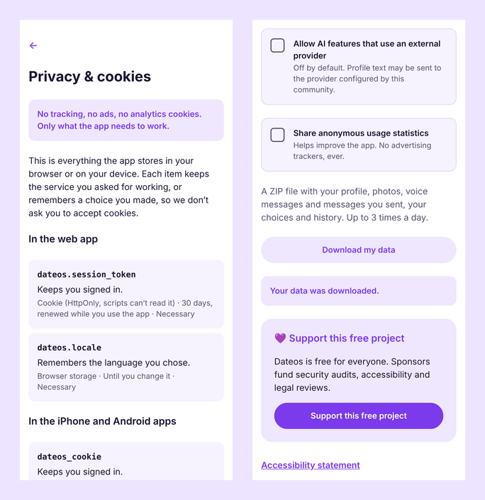

# Dateos: dating that respects you

**English** · [עברית](he.md) · [العربية](ar.md) · [Русский](ru.md)

**A free, open-source dating app for iPhone, Android and the web, which any city, community or
organisation can run under its own name.** No ads, no paywalls, no selling data: just people meeting
people, with safety and privacy built in.



## Why Dateos

|                                      |                                                                                                                                                                                                                                     |
| ------------------------------------ | ----------------------------------------------------------------------------------------------------------------------------------------------------------------------------------------------------------------------------------- |
| 🆓 **Free, forever, for everyone**   | Every feature is free: seeing who liked you, unlimited chat, voice messages. No premium tier and no "boosts". MIT license.                                                                                                          |
| 🏠 **Your community, your app**      | One install script gives you a branded app with your name, logo and colours, on your own server and your own domain. The data stays with you.                                                                                       |
| 💞 **Matching that explains itself** | It recommends people likely to like _each other_, shows why ("you both love hiking", "you share a language"), and spreads attention fairly so nobody is buried. The algorithm is published.                                         |
| 🛡️ **Safety from the first message** | Photo verification reviewed by a person (no face recognition), an "Are you sure?" check before hurtful messages, offensive messages hidden, scam warnings, blurred photos until you choose to look, and a report button everywhere. |
| 🔒 **Privacy by design**             | Sign-in without passwords, location only as a ~1 km area, a separate explicit consent for sensitive data, no tracking cookies, "Download my data" and "Delete my account" in two taps.                                              |
| 🤖 **AI you control**                | Smart matching and conversation starters run on your server by default. Cloud AI only with each member's consent.                                                                                                                   |
| 🌍 **Four languages, accessible**    | English, Hebrew, Arabic and Russian, with full right-to-left support. Screen readers, keyboard use, large text, and a button for every swipe.                                                                                       |
| 👮 **Moderation tools included**     | A dashboard with mandatory two-factor sign-in, a report queue with evidence, verification reviews and a complete audit log.                                                                                                         |

## A closer look

**Sign-up in a minute, with consent first**



**Chat with kindness built in**



**Safety and moderation**



**Voice messages** (the receiver can turn them off)



**Privacy you can check**



## Who it is for

- **Communities and organisations** that want a dating space of their own: a city, a university, a
  religious or cultural community, an LGBTQ+ organisation, a professional network.
- **Non-profits and social initiatives** that care about safety and dignity more than engagement.
- **Developers** who want a modern, tested, open codebase (TypeScript, React Native, PostgreSQL).

## Built to be trusted

- Tested end to end: 100+ integration tests, browser tests in four languages, automated accessibility
  checks (0 axe-core violations), a load test with 5 000 members.
- A published security review and privacy guide; draft privacy policy, terms and accessibility
  statement to adapt with your lawyer ⚖️.
- Nothing leaves your server unless you choose so: no analytics, no third-party scripts.

## Get started

```bash
git clone https://github.com/diamondrubinny/Dateos.git && cd Dateos
./install.sh --domain example.org
```

Then follow [the self-hosting guide](../SELF_HOSTING.md) and the [production checklist](../PRODUCTION_CHECKLIST.md).

💜 **Support the project:** [GitHub Sponsors](https://github.com/sponsors/diamondrubinny) funds security
audits, accessibility reviews and legal templates for everyone.

<sub>Dateos is created by Diamond Rubinny. Screenshots are real captures of the current build; profile
photos are illustrations. Legal texts are drafts, not legal advice.</sub>
