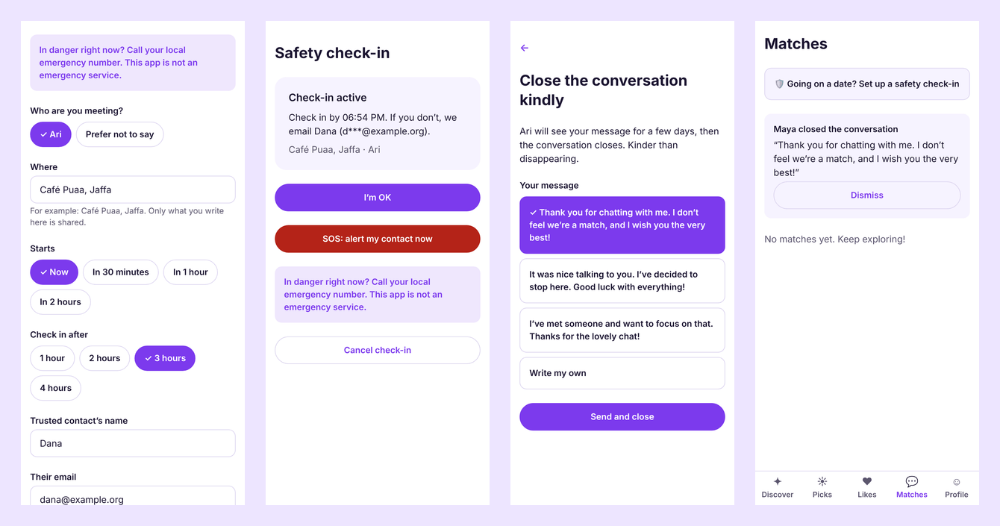
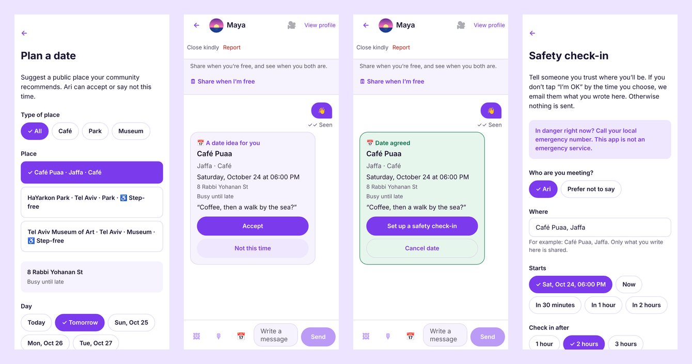
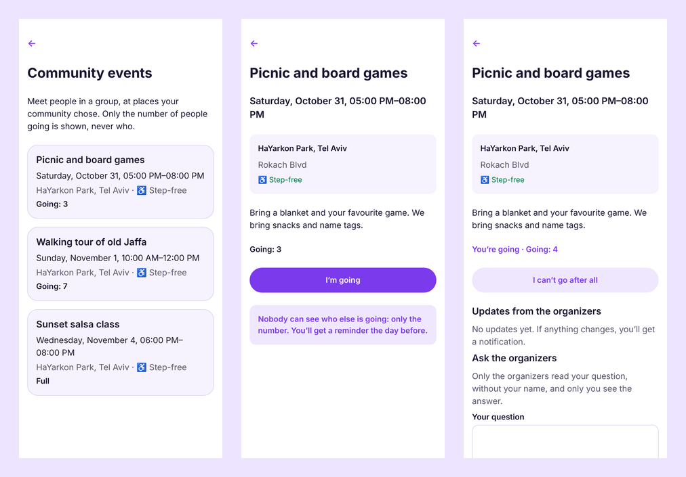
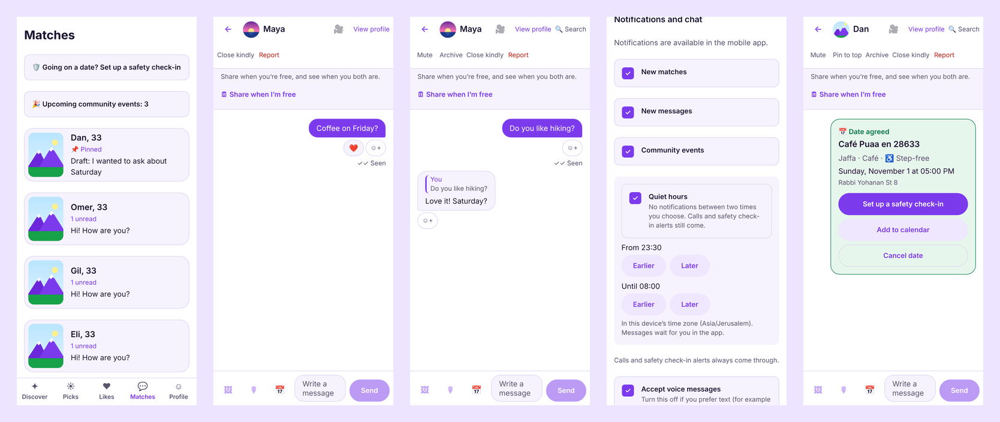
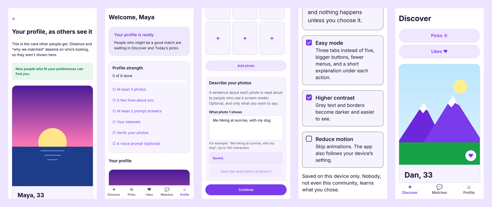
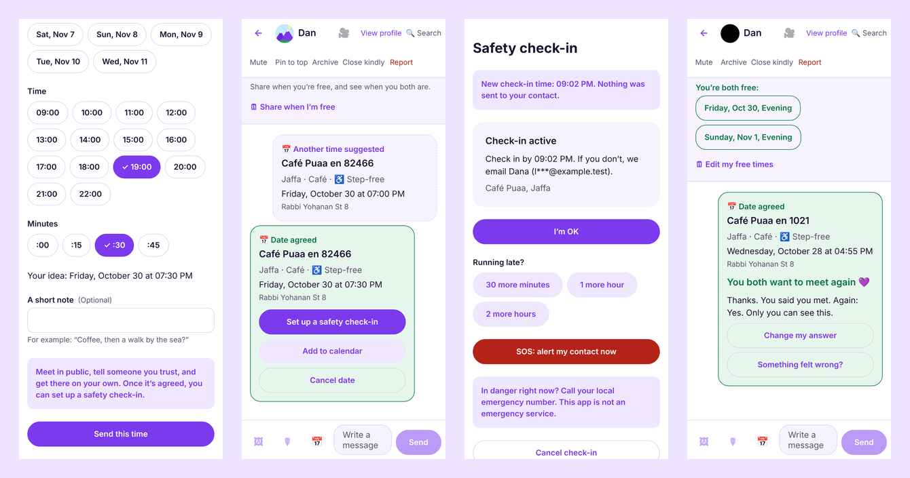
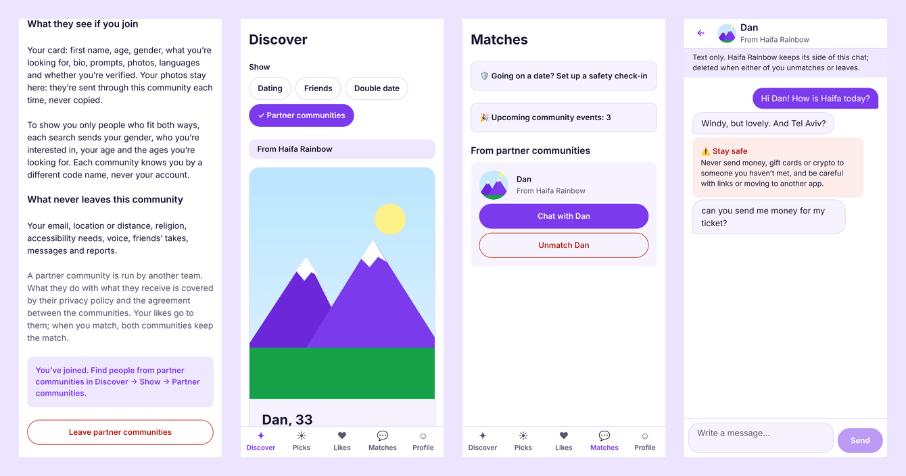
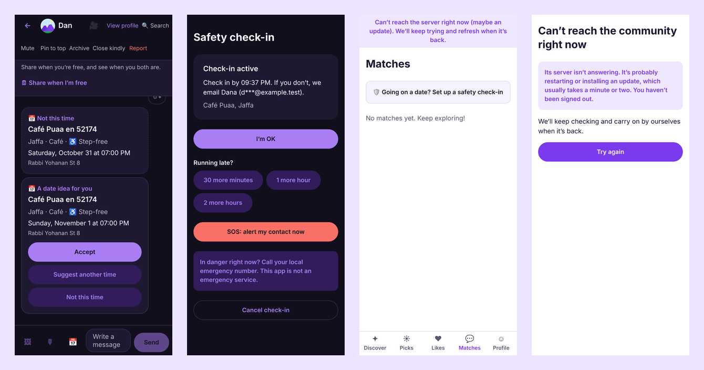
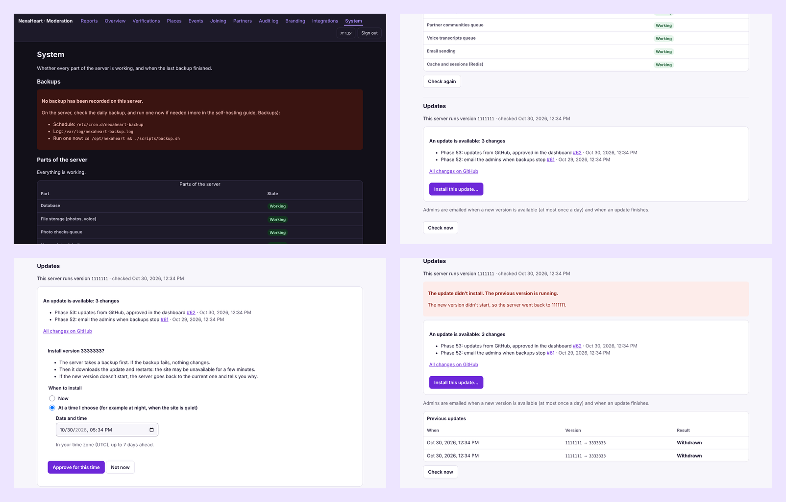

# NexaHeart: dating that respects you

**English** · [עברית](he.md) · [العربية](ar.md) · [Русский](ru.md)

**A free, open-source dating app for iPhone, Android and the web, which any city, community or
organisation can run under its own name.** No ads, no paywalls, no selling data: just people meeting
people, with safety and privacy built in.


## Why NexaHeart

|                                      |                                                                                                                                                                                                                                                                               |
| ------------------------------------ | ----------------------------------------------------------------------------------------------------------------------------------------------------------------------------------------------------------------------------------------------------------------------------- |
| 🆓 **Free, forever, for everyone**   | Every feature is free: seeing who liked you, unlimited chat, voice messages. No premium tier and no "boosts". Open source (AGPL-3.0).                                                                                                                                         |
| 🏠 **Your community, your app**      | One install script gives you a branded app with your name, logo and colours, on your own server and your own domain. The data stays with you.                                                                                                                                 |
| 💞 **Matching that explains itself** | It recommends people likely to like _each other_, shows why ("you both love hiking", "you share a language"), and spreads attention fairly so nobody is buried. The algorithm is published.                                                                                   |
| 🛡️ **Safety from the first message** | Photo verification reviewed by a person (no face recognition), an "Are you sure?" check before hurtful messages, offensive messages hidden, scam warnings, blurred photos until you choose to look, and a report button everywhere.                                           |
| 🔒 **Privacy by design**             | Sign-in without passwords, location only as a ~1 km area, a separate explicit consent for sensitive data, no tracking cookies, "Download my data" and "Delete my account" in two taps.                                                                                        |
| 🤖 **AI you control**                | Smart matching and conversation starters run on your server by default. Cloud AI only with each member's consent.                                                                                                                                                             |
| 🌍 **Four languages, accessible**    | English, Hebrew, Arabic and Russian, with full right-to-left support. Screen readers, keyboard use, large text, and a button for every swipe.                                                                                                                                 |
| 🛟 **Date safety, no ghosting**      | A safety check-in emails someone you trust only if you miss it or press SOS. "Close kindly" ends a chat with a polite message instead of silence, and gentle reminders show who is waiting for your reply.                                                                    |
| 📲 **An app without the app stores** | The web app installs to the home screen with your community's name, icon and colour, and opens even when the server restarts or the connection drops.                                                                                                                         |
| 🧰 **Runs itself**                   | One command over SSH installs it. Updates from GitHub appear in the dashboard with what was added or fixed, and install on an admin's approval (now or tonight), with a backup first and an automatic way back. Admins are emailed when backups stop or an update is waiting. |
| 🤝 **Communities that connect**      | Two communities can agree to let members who choose to meet and chat across both, with signed requests between the servers and nothing shared beyond the card.                                                                                                                |
| 👮 **Moderation tools included**     | A dashboard with mandatory two-factor sign-in, a report queue with evidence, verification reviews and a complete audit log.                                                                                                                                                   |

## A closer look

**Sign-up in a minute, with consent first**


**Chat with kindness built in**


**Safety and moderation**


**Voice messages** (the receiver can turn them off)


**Date safety and closing kindly**



**Plan a date in a place the community trusts**



**Community events**



**Everyday chat: pinned chats and drafts, reactions, replies, quiet hours, add to calendar**



**You, as others see you, and accessibility**



**Dates: another time, running late, after the date**



**Communities that connect**



**Dark mode, and when the server or the connection is away**



**Running it without a sysadmin**



**Privacy you can check**


## Who it is for

- **Communities and organisations** that want a dating space of their own: a city, a university, a
  religious or cultural community, an LGBTQ+ organisation, a professional network.
- **Non-profits and social initiatives** that care about safety and dignity more than engagement.
- **Developers** who want a modern, tested, open codebase (TypeScript, React Native, PostgreSQL).

## Built to be trusted

- Tested end to end: 355 integration tests, browser tests in four languages, automated accessibility
  checks (0 axe-core violations), a load test with 5 000 members.
- A published security review and privacy guide; draft privacy policy, terms and accessibility
  statement to adapt with your lawyer ⚖️.
- Nothing leaves your server unless you choose so: no analytics, no third-party scripts.

## Get started

```bash
ssh root@YOUR_SERVER_IP 'curl -fsSL https://raw.githubusercontent.com/diamondrubinny/NexaHeart/main/scripts/bootstrap.sh | DOMAIN=example.org SMTP_HOST=smtp.your-provider.example SMTP_USER=you@example.org SMTP_PASSWORD=your-smtp-password bash'
```

One command on a fresh Linux server, over SSH: it installs Docker if needed, downloads and configures NexaHeart, sets up encrypted daily backups and the updater, and prints the setup token. Point `example.org`, `admin.example.org` and `api.example.org` at the server first. Then follow [the step-by-step guide](../INSTALL.md) and the [production checklist](../PRODUCTION_CHECKLIST.md).

💜 **Support the project:** [GitHub Sponsors](https://github.com/sponsors/diamondrubinny) funds security
audits, accessibility reviews and legal templates for everyone.

<sub>NexaHeart is created by Diamond Rubinny. Screenshots are real captures of the current build; profile
photos are illustrations. Legal texts are drafts, not legal advice.</sub>
