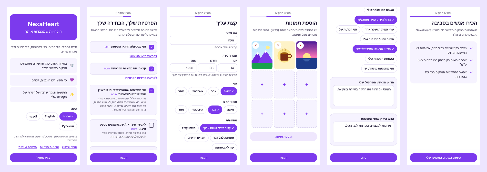
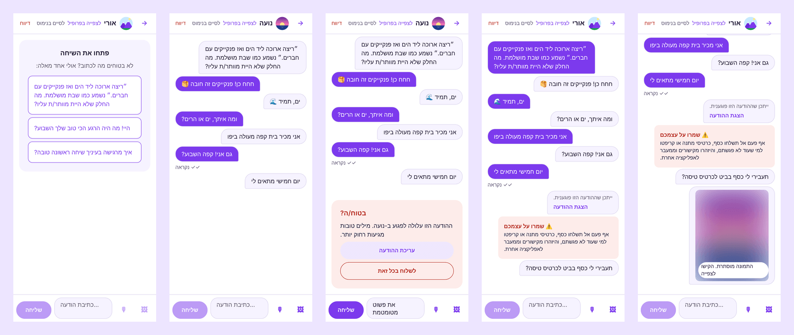
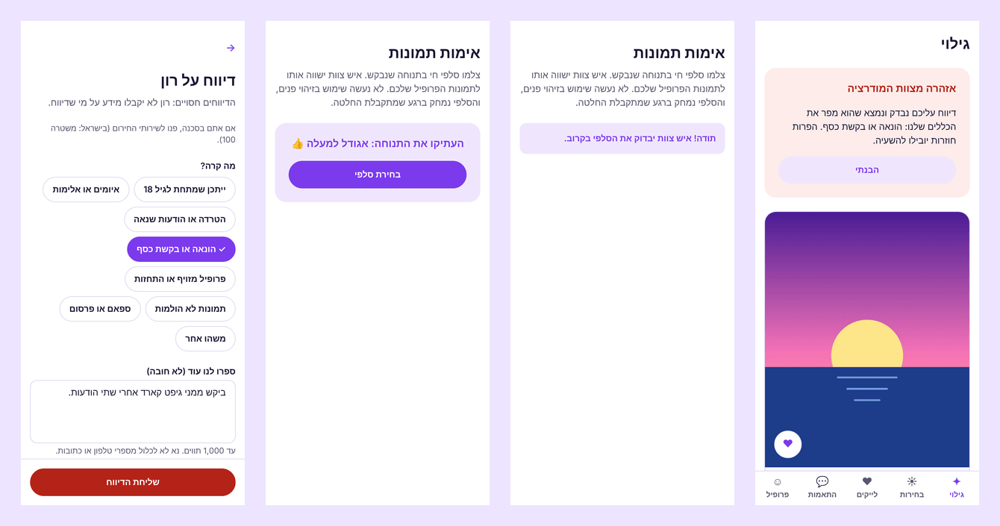
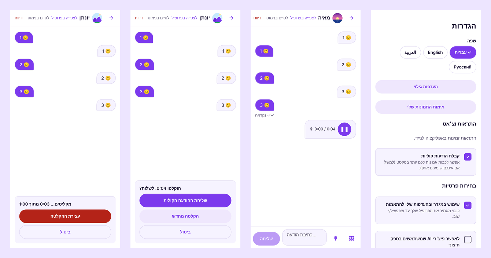
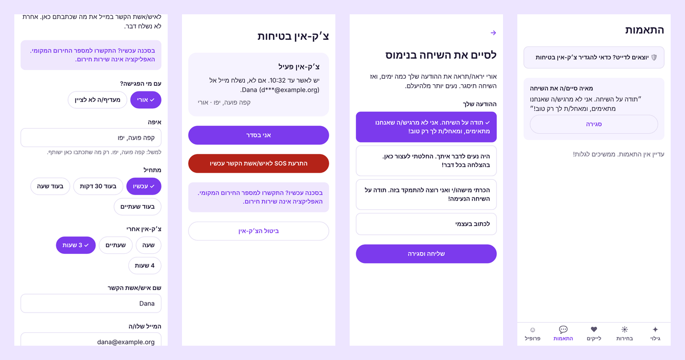
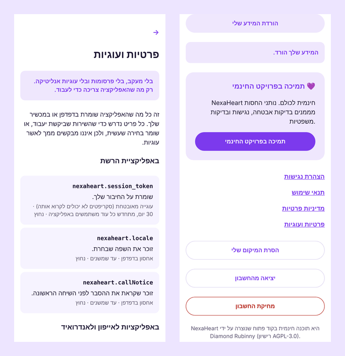

<div dir="rtl">

# Dateos: היכרויות שמכבדות אותך

[English](en.md) · **עברית** · [العربية](ar.md) · [Русский](ru.md)

**אפליקציית היכרויות חינמית בקוד פתוח לאייפון, לאנדרואיד ולרשת, שכל עיר, קהילה או ארגון יכולים
להפעיל בשם שלהם.** בלי פרסומות, בלי תשלומים ובלי מכירת מידע: רק אנשים שפוגשים אנשים, עם בטיחות
ופרטיות מובנות.


## למה Dateos

|                                    |                                                                                                                                                                                 |
| ---------------------------------- | ------------------------------------------------------------------------------------------------------------------------------------------------------------------------------- |
| 🆓 **חינם, לתמיד, לכולם**          | כל התכונות חינמיות: לראות מי עשה לך לייק, צ'אט ללא הגבלה, הודעות קוליות. אין מנוי פרימיום ואין "בוסטים". רישיון MIT.                                                            |
| 🏠 **הקהילה שלך, האפליקציה שלך**   | סקריפט התקנה אחד ומקבלים אפליקציה ממותגת עם השם, הלוגו והצבעים שלכם, על השרת והדומיין שלכם. המידע נשאר אצלכם.                                                                   |
| 💞 **התאמות שמסבירות את עצמן**     | ממליצה על אנשים שסביר שימצאו חן _זה בעיני זה_, מראה למה ("שניכם אוהבים טיולים", "יש לכם שפה משותפת"), ומפזרת תשומת לב בהוגנות כך שאף אחד לא נקבר. האלגוריתם פתוח לציבור.        |
| 🛡️ **בטיחות מההודעה הראשונה**      | אימות תמונה שנבדק בידי אדם (בלי זיהוי פנים), בדיקת "בטוח/ה?" לפני הודעה פוגענית, הסתרת הודעות פוגעניות, אזהרות מהונאה, תמונות מטושטשות עד שבוחרים לראות, וכפתור דיווח בכל מקום. |
| 🔒 **פרטיות כבר בתכנון**           | כניסה בלי סיסמה, מיקום רק כאזור של כקילומטר, הסכמה מפורשת ונפרדת למידע רגיש, בלי עוגיות מעקב, "הורדת המידע שלי" ו"מחיקת החשבון" בשתי לחיצות.                                    |
| 🤖 **AI בשליטתך**                  | ההתאמות החכמות והצעות לפתיחת שיחה רצות כברירת מחדל על השרת שלכם. AI בענן רק בהסכמת כל משתמש/ת.                                                                                  |
| 🌍 **ארבע שפות, נגיש**             | עברית, אנגלית, ערבית ורוסית, עם תמיכה מלאה מימין לשמאל. קוראי מסך, מקלדת, טקסט גדול, וכפתור לכל החלקה.                                                                          |
| 🛟 **בטיחות בדייט, בלי היעלמויות** | צ׳ק-אין בטיחות שולח מייל למי שאתם סומכים עליו רק אם לא אישרתם או לחצתם SOS. "לסיים בנימוס" סוגר שיחה בהודעה מכבדת במקום שתיקה, ותזכורות עדינות מראות מי מחכה לתשובה שלכם.       |
| 👮 **כלי מודרציה כלולים**          | לוח ניהול עם כניסה דו-שלבית חובה, תור דיווחים עם ראיות, בדיקת אימותים ויומן פעולות מלא.                                                                                         |

## מבט מקרוב

**הרשמה בדקה, והסכמה קודם לכול**



**צ'אט עם אדיבות מובנית**



**בטיחות ומודרציה**



**הודעות קוליות** (המקבל/ת יכול/ה לכבות אותן)



**בטיחות בדייט וסיום בנימוס**



**פרטיות שאפשר לבדוק**



## למי זה מתאים

- **קהילות וארגונים** שרוצים מרחב היכרויות משלהם: עיר, אוניברסיטה, קהילה דתית או תרבותית, ארגון
  להט"ב, רשת מקצועית.
- **עמותות ויוזמות חברתיות** שחשובים להן בטיחות וכבוד יותר מזמן מסך.
- **מפתחים ומפתחות** שרוצים בסיס קוד מודרני, בדוק ופתוח (TypeScript, React Native, PostgreSQL).

## בנוי כדי שיהיה אפשר לסמוך עליו

- נבדק מקצה לקצה: יותר מ-100 בדיקות אינטגרציה, בדיקות דפדפן בארבע שפות, בדיקות נגישות אוטומטיות
  (0 הפרות axe-core), ובדיקת עומס עם 5,000 משתמשים.
- סקירת אבטחה ומדריך פרטיות פומביים; טיוטות של מדיניות פרטיות, תנאי שימוש והצהרת נגישות להתאמה עם
  עורך/ת דין ⚖️.
- שום דבר לא יוצא מהשרת שלכם אלא אם תבחרו: בלי אנליטיקה ובלי סקריפטים של צד שלישי.

## איך מתחילים

```bash
git clone https://github.com/diamondrubinny/Dateos.git && cd Dateos
./install.sh --domain example.org
```

ואחר כך [המדריך להקמה עצמית](../SELF_HOSTING.md) ו[רשימת הבדיקות לפני עלייה לאוויר](../PRODUCTION_CHECKLIST.md).

💜 **תמיכה בפרויקט:** [GitHub Sponsors](https://github.com/sponsors/diamondrubinny) מממן ביקורות אבטחה,
בדיקות נגישות ותבניות משפטיות לטובת כולם.

<sub>את Dateos יצר/ה Diamond Rubinny. צילומי המסך אמיתיים מהגרסה הנוכחית; תמונות הפרופיל הן
איורים. המסמכים המשפטיים הם טיוטות ואינם ייעוץ משפטי.</sub>

</div>
