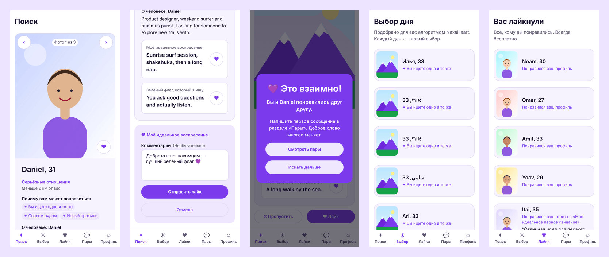
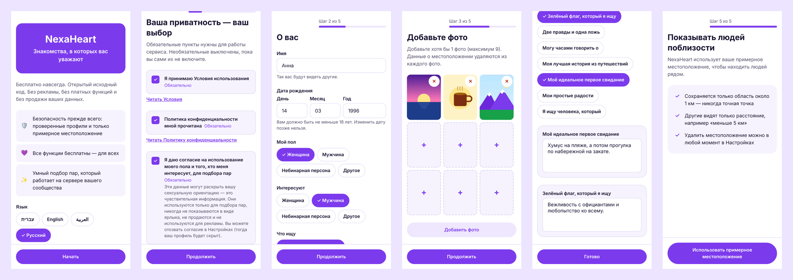
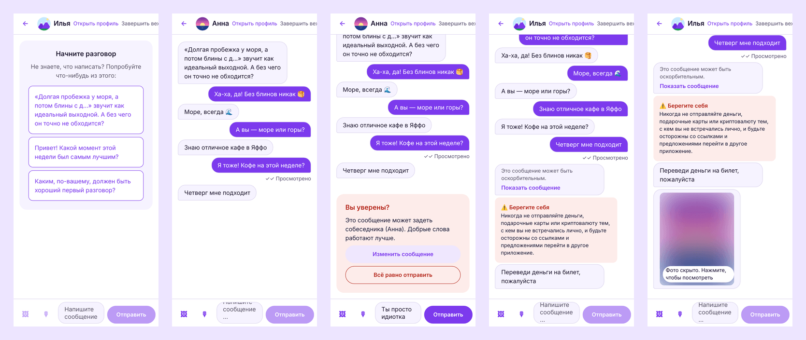
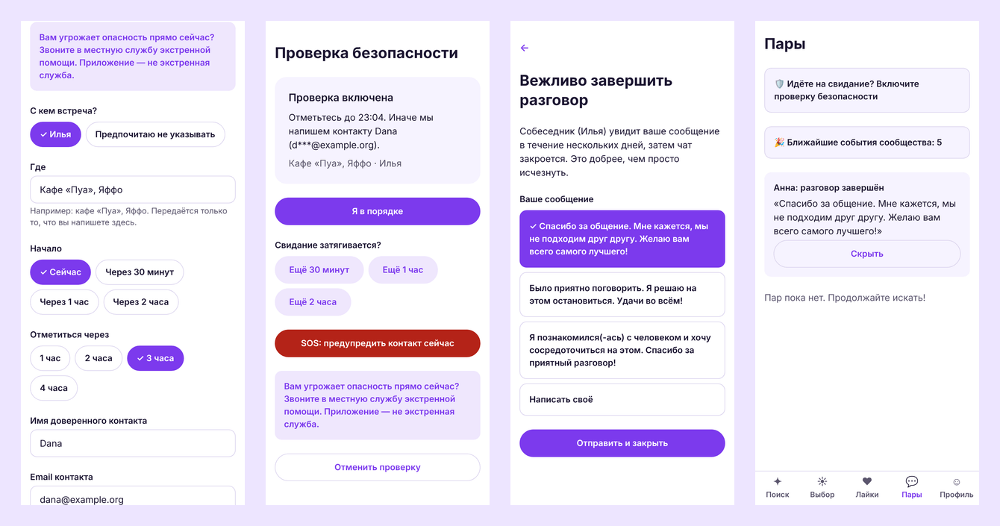
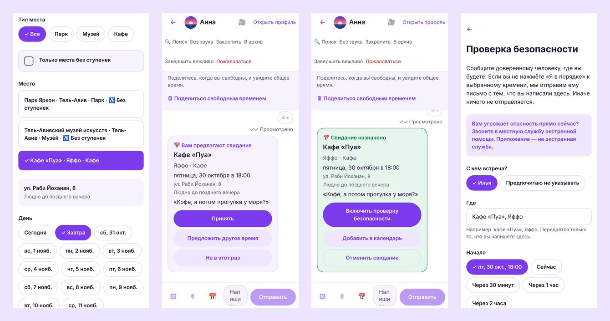
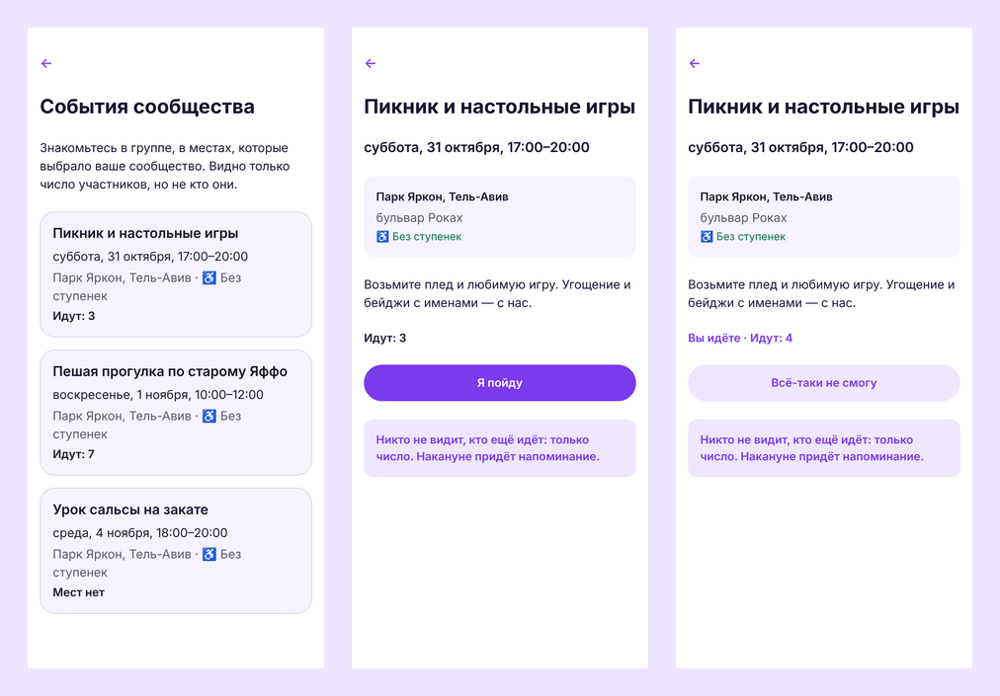
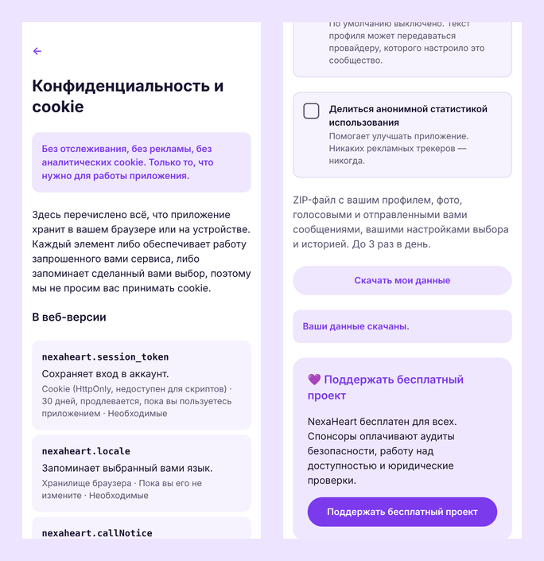

# NexaHeart: ваши люди, ваш сервер, ваш человек

[English](en.md) · [עברית](he.md) · [العربية](ar.md) · **Русский**

**Бесплатное приложение для знакомств с открытым исходным кодом для iPhone, Android и веба, которое
любой город, сообщество или организация может запустить под своим именем.** Без рекламы, без платных
функций и без продажи данных: просто люди знакомятся с людьми, а безопасность и приватность встроены с
самого начала.



## Почему NexaHeart

|                                            |                                                                                                                                                                                                                                      |
| ------------------------------------------ | ------------------------------------------------------------------------------------------------------------------------------------------------------------------------------------------------------------------------------------ |
| 🆓 **Бесплатно, навсегда и для всех**      | Все функции бесплатны: видеть, кому вы понравились, общаться без ограничений, отправлять голосовые сообщения. Нет премиум-подписки и «бустов». Открытый исходный код (AGPL-3.0).                                                     |
| 🏠 **Ваше сообщество, ваше приложение**    | Один установочный скрипт — и у вас приложение с вашим названием, логотипом и цветами, на вашем сервере и домене. Данные остаются у вас.                                                                                              |
| 💞 **Подбор, который объясняет себя**      | Рекомендует людей, которые с большой вероятностью понравятся _друг другу_, показывает почему («вы оба любите походы», «у вас общий язык») и честно распределяет внимание, чтобы никто не остался незамеченным. Алгоритм опубликован. |
| 🛡️ **Безопасность с первого сообщения**    | Проверка фото человеком (без распознавания лиц), вопрос «Вы уверены?» перед обидным сообщением, скрытие оскорблений, предупреждения о мошенничестве, размытые фото до вашего решения их открыть и кнопка жалобы везде.               |
| 🔒 **Приватность заложена в основу**       | Вход без пароля, местоположение только как зона около 1 км, отдельное явное согласие на чувствительные данные, никаких отслеживающих cookie, «Скачать мои данные» и «Удалить аккаунт» в два нажатия.                                 |
| 🤖 **ИИ под вашим контролем**              | Умный подбор и подсказки для начала разговора по умолчанию работают на вашем сервере. Облачный ИИ — только с согласия каждого участника.                                                                                             |
| 🌍 **Четыре языка и доступность**          | Русский, английский, иврит и арабский, с полной поддержкой письма справа налево. Экранные дикторы, управление с клавиатуры, крупный текст и кнопка для каждого свайпа.                                                               |
| 🛟 **Безопасные свидания, без «гостинга»** | Проверка безопасности пишет доверенному человеку, только если вы не отметились или нажали SOS. «Завершить вежливо» закрывает чат добрым сообщением вместо молчания, а мягкие напоминания показывают, кто ждёт вашего ответа.         |
| 📲 **Приложение без магазинов**            | Веб-приложение устанавливается на главный экран с названием, значком и цветом вашего сообщества и открывается, даже когда сервер перезапускается или нет связи.                                                                      |
| 🧰 **Обслуживает себя само**               | Одна команда по SSH устанавливает всё. Обновления с GitHub появляются в панели с описанием изменений и ставятся после одобрения администратора (сразу или ночью), с резервной копией и автоматическим откатом.                       |
| 👮 **Инструменты модерации в комплекте**   | Панель управления с обязательной двухфакторной авторизацией, очередь жалоб с доказательствами, проверка верификаций и полный журнал действий.                                                                                        |

## Подробнее

**Регистрация за минуту, и сначала — согласие**



**Чат, в котором доброта встроена**



**Безопасные свидания и вежливое завершение**



**Свидание в месте, которому доверяет сообщество**



**События сообщества**



**Приватность, которую можно проверить**



## Для кого

- **Сообщества и организации**, которым нужно собственное пространство для знакомств: город,
  университет, религиозное или культурное сообщество, ЛГБТК+-организация, профессиональная сеть.
- **НКО и социальные инициативы**, для которых безопасность и достоинство важнее времени в приложении.
- **Разработчики**, которым нужна современная, протестированная и открытая кодовая база (TypeScript,
  React Native, PostgreSQL).

## Создано, чтобы ему доверяли

- Проверено от начала до конца: 366 интеграционных тестов, браузерные тесты на четырёх языках,
  автоматические проверки доступности (0 нарушений axe-core), нагрузочный тест с 5 000 участников.
- Открытый обзор безопасности и руководство по приватности; черновики политики конфиденциальности,
  условий использования и заявления о доступности, которые нужно адаптировать вместе с юристом ⚖️.
- Ничто не покидает ваш сервер без вашего решения: никакой аналитики и сторонних скриптов.

## Как начать

```bash
ssh root@YOUR_SERVER_IP 'curl -fsSL https://raw.githubusercontent.com/diamondrubinny/NexaHeart/main/scripts/bootstrap.sh | DOMAIN=example.org SMTP_HOST=smtp.your-provider.example SMTP_USER=you@example.org SMTP_PASSWORD=your-smtp-password bash'
```

Одна команда на новом Linux-сервере по SSH: при необходимости ставит Docker, скачивает и настраивает NexaHeart, включает зашифрованные ежедневные резервные копии и обновления и выводит код настройки. Сначала направьте `example.org`, `admin.example.org` и `api.example.org` на сервер. Затем — [пошаговое руководство](../INSTALL.md) и [чек-лист перед запуском](../PRODUCTION_CHECKLIST.md) (на английском).

💜 **Поддержите проект:** [GitHub Sponsors](https://github.com/sponsors/diamondrubinny) финансирует аудит
безопасности, проверки доступности и юридические шаблоны для всех.

<sub>NexaHeart создан Diamond Rubinny. Скриншоты — реальные снимки текущей версии; фото в профилях —
иллюстрации. Юридические тексты — черновики, а не юридическая консультация.</sub>
